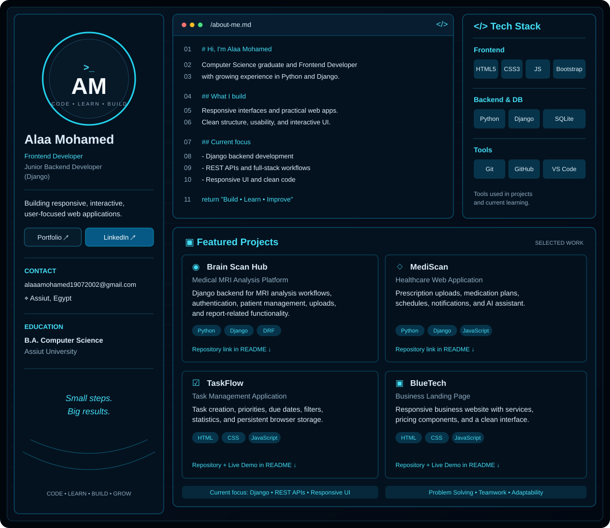

  

Alaa Mohamed
Frontend Developer | Junior Backend Developer (Django)

I build responsive interfaces and practical web applications, and I'm expanding my backend skills with Python and Django.
Real links
These are clickable Markdown links. The text drawn inside the SVG above is only part of the image and cannot act as separate links.
- Portfolio: Visit my portfolio
- LinkedIn: Connect with me
- GitHub: View my GitHub profile
- Email: Contact me
Projects
MediScan — Healthcare Web Application
A Django-based healthcare application with prescription uploads, medication plans, schedules, notifications, and AI-assistant work in progress.
- Open the MediScan repository
TaskFlow — Task Management Application
A browser-based task manager with task creation, priorities, due dates, filtering, statistics, and Local Storage persistence.
- Open the TaskFlow source code
- Try the TaskFlow live demo
BlueTech — Business Landing Page
A responsive business landing page with service sections, pricing components, and a clean interface.
- Open the BlueTech source code
- Try the BlueTech live demo
AlAhly Website — Sports Website
A responsive football-club website with structured sections, visual content, galleries, and CSS animations.
- Open the AlAhly source code
- Try the AlAhly live demo
Brain Scan Hub — Graduation Project
Django-based backend for an MRI-analysis workflow, including authentication, role-based access, patient management, MRI uploads, and reporting functionality.
- Repository link not added yet: add the exact public GitHub repository URL here so visitors are not sent to an incorrect destination.

  **Code · Learn · Build · Grow**

